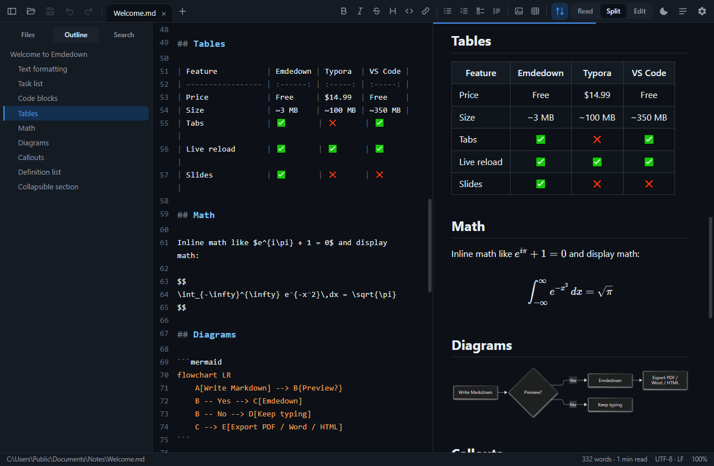

# Emdedown


A fast, beautiful, **offline** Markdown reader & editor for Windows 10/11 — in a single file of about 3.6 MB.

Emdedown: say it "em-dee-down", as in .md + Markdown.



## Install (anyone can do this)

1. Download **`Emdedown.exe`** from the [Releases page](../../releases/latest) and double-click it.
2. Click **Install Emdedown**. No admin rights, no setup wizard. Tick **Also add a shortcut to my desktop** if you want one (it's off by default).
3. Say **Yes** when it asks to open `.md` files with Emdedown. If you never picked an app for `.md` files, that's it.
   If another app opens them today, Windows makes you confirm the switch yourself: Emdedown opens
   **Settings → Default apps**; click **Choose default apps by file type**, find **.md**, and pick **Emdedown**.

That's it — it's now in your Start menu (and on your desktop, if you ticked the box), and `.md` files open with a double-click.
You can add or remove the desktop shortcut later in Settings ⚙.

**Light on resources:** about 180 MB of memory with a document open, ~0% CPU when idle, less when minimized.
(GPU rendering is off by default because it costs ~100 MB more for no visible benefit on documents — turn it on in Settings if you like.)
Prefer not to install? Click **Just run it this time (portable)** — it works as a portable app from anywhere (USB stick included).

> **First launch warning:** because the app isn't code-signed (that costs money), Windows may say
> *"Windows protected your PC"*. Click **More info → Run anyway**.

**Uninstall:** Windows Settings → Apps → Emdedown → Uninstall (or Settings ⚙ inside the app). The program, its shortcuts,
its file associations and its own settings and data are removed; your documents are never touched.

## What you get

| | |
|---|---|
| **Reading** | GitHub-style rendering, tables, task lists, footnotes, emoji, definition lists, `==highlight==`, sub/superscript, callouts (`> [!NOTE]`), YAML front matter, `[[wiki links]]` |
| **Code, math, diagrams** | Syntax highlighting (35+ languages, copy button), KaTeX math (`$…$`, `$$…$$`), Mermaid diagrams — all offline |
| **Navigation** | Tabs, folder sidebar, outline with current-section highlight, reading progress, full-text search across a folder, quick file switcher (Ctrl+P), command palette (Ctrl+Shift+P), find in page (Ctrl+F) |
| **Editing** | Read / Split / Edit modes (Ctrl+E), live preview with synced scrolling, Open / Save / Undo / Redo buttons, formatting buttons and right-click formatting (bold, italic, headings, lists…), formatting shortcuts, paste or drop images (saved to `./images/`) or insert an image file, click checkboxes to tick tasks, autosave, crash-safe drafts, spellcheck |
| **Live reload** | Edits made in other programs show up instantly |
| **Look** | 6 themes (GitHub, Sepia, Solarized, Nord, Dracula, Paper), each with a light and a dark version; choose Light, Dark or Follow Windows. Plus your own CSS, font/size/width/line-spacing, focus mode (F11), dark title bar |
| **Share** | Export PDF, Word (.docx), self-contained HTML, copy as rich text, print, present as slides (F5) |
| **Safe** | Scripts in documents never run; links never launch programs; no telemetry and no network use, except that images a document links to on the web are fetched. |

Press **F1** in the app for all keyboard shortcuts; the full list is also in the [user guide](samples/Guide.md#keyboard-shortcuts).

**Learn more:** the [user guide](samples/Guide.md) shows every kind of formatting Emdedown understands, the names of the parts
of the window, slides and exporting. [Welcome.md](samples/Welcome.md) is a short feature tour. Both are built into the app: click **Open the guide** on the start page, or run that command
from the command list (Ctrl+Shift+P).

## How it compares

| | Emdedown | Typora | MarkText | Obsidian | VS Code |
|---|---|---|---|---|---|
| Price | Free | $14.99 | Free | Free (sync paid) | Free |
| Download | **~3.6 MB, 1 file** | ~100 MB | ~200 MB | ~300 MB | ~350 MB |
| Tabs + folder search | ✅ | ❌ tabs | ✅ | ✅ | ✅ |
| Slides / Word export | ✅ / ✅ | ❌ / ✅ (pandoc) | ❌ / ❌ | plugin | extension |
| WYSIWYG editing | Split view | ✅ | ✅ | ✅ | ❌ |

<sub>Figures for other apps are approximate, as of late 2026, and may change.</sub>

## Privacy

Emdedown has no telemetry, no accounts and no update checks. It does not use the network, except to load images that a
document links to on the web (as any Markdown viewer does). Settings and unsaved drafts stay on your PC in
`%LOCALAPPDATA%\Emdedown`.

## Requirements

- Windows 10 or 11.
- .NET Framework 4.8 — included in Windows 10 from version 1903 on, and in Windows 11.
- Microsoft Edge WebView2 Runtime — present on Windows 11 and on up-to-date Windows 10. If it is missing, Emdedown says so and
  offers to open Microsoft's download page.

## Building from source

You need:

- 64-bit Windows with .NET Framework 4.x. The C# compiler that ships with it (`csc.exe`) is used, so no Visual Studio or .NET SDK is required.
- **Node.js** (build time only).
- An internet connection for the first build: it installs the npm packages and downloads the WebView2 SDK from nuget.org
  (the download is checked against a pinned SHA-256 hash).

```powershell
.\build.ps1           # -> dist\Emdedown.exe
.\build.ps1 -SkipWeb  # rebuild only the C# host, reusing the existing web bundle
```

- `web/src` — the UI (markdown-it, highlight.js, KaTeX, Mermaid, CodeMirror 6, DOMPurify), bundled by esbuild.
- `src/` — the Windows host (.NET Framework 4.8 WinForms + Microsoft Edge WebView2). Web assets, the WebView2 SDK DLLs and loader are embedded (gzip) into the single exe.
- Data (settings, WebView cache) lives in `%LOCALAPPDATA%\Emdedown`; custom themes go in `%LOCALAPPDATA%\Emdedown\themes`.
- `tools/make-icon.ps1` regenerates `src/app.ico`.
- `tools/make-notices.mjs` regenerates `THIRD-PARTY-NOTICES.md`; run it after changing a dependency.

How it all fits together (host, page, protocol, security model): [docs/ARCHITECTURE.md](docs/ARCHITECTURE.md).

## License

Emdedown is released under the [MIT License](LICENSE), copyright (c) 2026 Emdedown contributors. It includes third-party components under their own licenses; see
[THIRD-PARTY-NOTICES.md](THIRD-PARTY-NOTICES.md).
