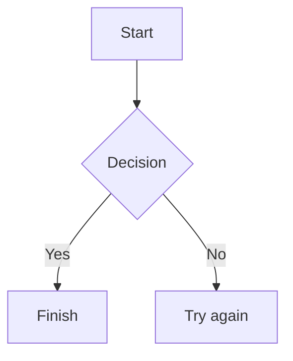
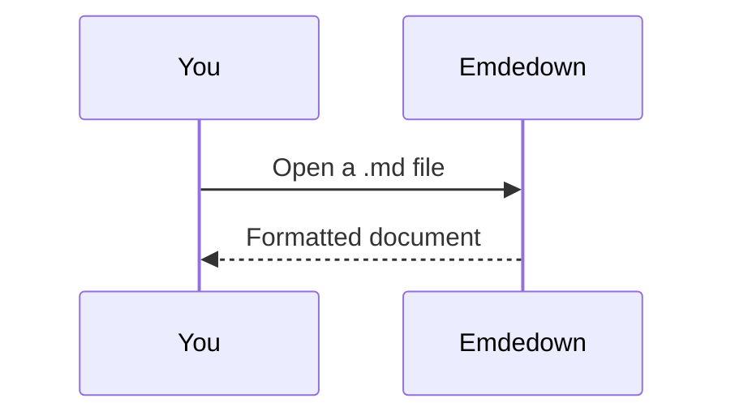

# Emdedown guide


Everything Emdedown can show, how to write it, and what the parts of the window are called. Open this file in
**Split** mode to see the Markdown on the left and the result on the right. Back to [Welcome](Welcome.md).

> [!TIP]
> Press **Ctrl+Shift+P** for the command list: every action in Emdedown, searchable by name.

## Parts of the window

| Name | Where | What it does |
| --- | --- | --- |
| **Toolbar** | The bar along the top | Holds the buttons and the tabs |
| **Tabs** / **tab strip** | In the toolbar | One tab per open document. Right-click a tab for Close, Close others, Close all, Copy path… A thin bar under them appears when they don't all fit |
| **Formatting buttons** | Toolbar, right side, while editing | Bold, Italic, Heading, lists, Link, Image, Table… (the same as the shortcuts below) |
| **Mode switch** | Toolbar: **Read · Split · Edit** | Read shows the result only, Split shows text and result side by side, Edit shows the text only |
| **Sync scroll button** | Left of the mode switch, in Split mode | When on (highlighted), the two sides scroll together |
| **Sidebar** | Left edge | **Files** (the open folder), **Outline** (the headings of this document), **Search** (search every file in the folder) |
| **Editor** | Left side in Split mode | Where you type the Markdown |
| **Preview** | Right side in Split mode, everything in Read mode | The formatted result |
| **Divider** | The line between editor and preview | Drag it to resize. Double-click to centre it. Right-click for sizes like 80 / 20 |
| **Status bar** | The bar along the bottom | File path (click to show it in Explorer), cursor position, word count, encoding, text size |
| **Command list** | **Ctrl+Shift+P** or the ☰ button | Search and run any command |
| **Tooltip** | Hover over a button | The small label that says what a button does and its shortcut |

## Headings

Start a line with one to six `#` and a space. The **Outline** in the sidebar lists them, and **Ctrl+R** jumps to one.

```markdown
# Heading 1
## Heading 2
### Heading 3
###### Heading 6
```

In the editor, **Ctrl+1 / Ctrl+2 / Ctrl+3** (or the **H** formatting button) turn the current line into a heading. Choosing
another level replaces the old one; choosing the same level again turns the heading back into normal text.

## Text styles

| Write | Result | Shortcut |
| --- | --- | --- |
| `*italic*` or `_italic_` | *italic* | Ctrl+I |
| `**bold**` or `__bold__` | **bold** | Ctrl+B |
| `***both***` | ***both*** | |
| `~~struck out~~` | ~~struck out~~ | Ctrl+Shift+X |
| `` `inline code` `` | `inline code` | Ctrl+` |
| `==highlight==` | ==highlight== | |
| `H~2~O` | H~2~O | |
| `x^2^` | x^2^ | |
| `<kbd>Ctrl</kbd>+<kbd>S</kbd>` | <kbd>Ctrl</kbd>+<kbd>S</kbd> | |
| `:rocket: :tada: :+1:` | :rocket: :tada: :+1: | |

You **can** _combine **them**_. End a line with two spaces (or a `\`) to break it without starting a new paragraph.

## Lists

```markdown
- Item one
- Item two
    - Indented item (four spaces or a tab)

1. First
2. Second
    1. Indented

- [ ] A task
- [x] A finished task
```

- Item one
- Item two
    - Indented item

1. First
2. Second
    1. Indented

- [ ] A task — click the box in the preview to tick it
- [x] A finished task

Ticking a box changes the `[ ]` in the file; if the document had no other unsaved changes, it is saved straight away.
**Ctrl+Shift+8** (bullets), **Ctrl+Shift+7** (numbers) and **Ctrl+Shift+C** (tasks) switch the selected lines between list types.

## Links

```markdown
[A website](https://commonmark.org)
[Another document](Welcome.md)
[A heading in another document](Welcome.md#code-blocks)
[A heading on this page](#tables)
[[Welcome]] and [[Welcome|a wiki link with its own text]]
https://github.com
```

[A website](https://commonmark.org) ·
[Another document](Welcome.md) ·
[A heading in another document](Welcome.md#code-blocks) ·
[A heading on this page](#tables) ·
[[Welcome]] · [[Welcome|a wiki link with its own text]] ·
https://github.com

Web links open in your browser. Links to other Markdown files open them in a new tab. Wiki links (`[[Name]]`) find a
file by name in the open folder. A heading's link name is its text in lower case with spaces turned into `-`.

## Images

```markdown

```


The path is relative to the document. Easier: **paste** an image (Ctrl+V) or **drag** one into the editor. Emdedown saves it
in an `images` folder next to the document and writes the link for you. Click an image in the preview to enlarge it.

## Quotes

```markdown
> Markdown is a lightweight markup language created in 2004 by John Gruber with Aaron Swartz.
>
>> Quotes can be nested.
```

> Markdown is a lightweight markup language created in 2004 by John Gruber with Aaron Swartz.
>
>> Quotes can be nested.

## Callouts

A quote whose first line is `[!NOTE]`, `[!TIP]`, `[!IMPORTANT]`, `[!WARNING]` or `[!CAUTION]` becomes a coloured box.

```markdown
> [!NOTE]
> Useful information that users should know.
```

> [!NOTE]
> Useful information that users should know.

> [!TIP]
> A helpful suggestion.

> [!IMPORTANT]
> Something people need to know to succeed.

> [!WARNING]
> Urgent information that needs attention.

> [!CAUTION]
> Possible bad consequences of an action.

## Tables

```markdown
| Left aligned | Centred | Right aligned |
| :----------- | :-----: | ------------: |
| left         | middle  | 1.00          |
| text         | text    | 10.50         |
```

| Left aligned | Centred | Right aligned |
| :----------- | :-----: | ------------: |
| left         | middle  | 1.00          |
| text         | text    | 10.50         |

The colons in the second row set the alignment. The **Insert table** formatting button writes a starting table for you.

## Code

Wrap code in three backticks. Name the language after the opening backticks for colours (JavaScript, Python, C#, HTML,
CSS, JSON, SQL, Bash and about 30 more). Hover over a block in the preview for a **Copy** button.

````markdown
```javascript
let message = 'Hello world';
alert(message);
```
````

```javascript
let message = 'Hello world';
alert(message);
```

## Math

Write formulas in LaTeX between `$` signs (in a line) or `$$` (on their own lines).

```markdown
Inline: $e^{i\pi} + 1 = 0$

$$
\int_{-\infty}^{\infty} e^{-x^2}\,dx = \sqrt{\pi}
$$
```

Inline: $e^{i\pi} + 1 = 0$

$$
\int_{-\infty}^{\infty} e^{-x^2}\,dx = \sqrt{\pi}
$$

## Diagrams

A code block named `mermaid` is drawn as a diagram: flowcharts, sequence diagrams, timelines, pie charts and more
(see mermaid.js.org for every kind).

````markdown

````




## Collapsible sections

```markdown
<details>
<summary>Click to expand</summary>

Hidden until opened. Leave a blank line after the summary so Markdown inside still works.

</details>
```

<details>
<summary>Click to expand</summary>

Hidden until opened. Leave a blank line after the summary so Markdown inside still works.

</details>

## Footnotes and definitions

```markdown
A sentence with a footnote.[^1]

[^1]: The note appears at the bottom of the document.

Markdown
: A lightweight markup language for formatted text.
```

A sentence with a footnote.[^1]

[^1]: The note appears at the bottom of the document.

Markdown
: A lightweight markup language for formatted text.

## Document details (front matter)

A block between two `---` lines at the very top of a file is shown as a small table of details at the top of the
preview, like the one at the start of [Welcome](Welcome.md).

```markdown
---
title: My notes
author: You
tags: [work, ideas]
---
```

## Raw HTML

Simple HTML such as `<kbd>`, `<details>`, `<sub>`, `<br>` and `` works. For safety, scripts, styles,
forms and embedded pages are always removed.

## Keyboard shortcuts

| Keys | Action |
| --- | --- |
| Ctrl+O / Ctrl+Shift+O | Open a file / a folder |
| Ctrl+N | New document |
| Ctrl+S / Ctrl+Shift+S | Save / Save as |
| Ctrl+W | Close the tab |
| Ctrl+Shift+T | Reopen the last closed tab |
| Ctrl+Tab / Ctrl+Shift+Tab | Next / previous tab |
| Ctrl+E | Switch Read → Split → Edit |
| Ctrl+P | Go to a file in the open folder |
| Ctrl+R | Go to a heading |
| Ctrl+F | Find in the document |
| Ctrl+Shift+F | Search every file in the folder |
| Ctrl+Shift+P | Command list |
| Ctrl+\ | Show or hide the sidebar |
| Ctrl+B / Ctrl+I / Ctrl+K | Bold / italic / link |
| Ctrl+1 / 2 / 3 | Heading level 1 / 2 / 3 |
| Ctrl+Shift+8 / 7 / C | Bulleted / numbered / task list |
| Ctrl+Shift+. | Quote |
| Ctrl+Z / Ctrl+Y | Undo / redo |
| Ctrl+= / Ctrl+- / Ctrl+0 (or Ctrl+mouse wheel) | Bigger / smaller / normal text |
| Ctrl+Shift+L | Light / dark |
| F11 | Focus mode (only the document) |
| F5 | Present as slides |
| Ctrl+Alt+P | Print |
| Ctrl+, | Settings |
| F1 | All shortcuts |

## Slides

Press **F5** to present the document. A new slide starts at every `#` and `##` heading and at every line with just `---`
(the `---` itself is not shown). A slide with too much on it continues on the next one.

Move with the arrow keys, Space or a click (click the left third of the screen to go back). **Esc** ends the presentation.

## Themes

Every theme comes in a light and a dark version: **GitHub**, **Sepia**, **Solarized**, **Nord**, **Dracula** and **Paper**
(serif). Pick the theme in **Settings** (Ctrl+,) or with **Change theme…** in the command list. Pick **Light**, **Dark** or
**Follow Windows** under *Appearance*. The moon button (Ctrl+Shift+L) switches between the two versions of your theme.
Printing and PDF always use the light version.

## Saving and exporting

- Unsaved documents have a ● on their tab. If Emdedown or Windows closes unexpectedly, your unsaved text comes back next time.
- **Autosave** (Settings) saves a second after you stop typing.
- **Export as PDF, HTML or Word**, **Print** and **Copy as HTML** (for pasting into Word or email) are in the command list.
