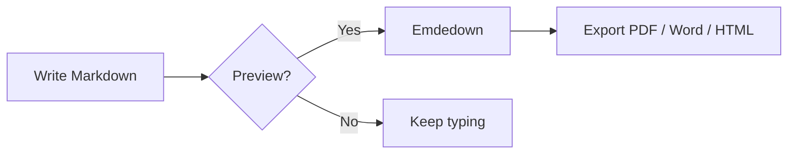

# Welcome to Emdedown

Emdedown is a **fast**, *beautiful* and ~~bloated~~ tiny Markdown reader & editor. Everything on this page renders **offline**. :rocket:

> [!TIP]
> Press **Ctrl+E** to switch between *Read*, *Split* and *Edit* mode, or **Ctrl+Shift+P** to see every command.

## Text formatting

You can use **bold**, *italic*, ***both***, `inline code`, ==highlights==, H~2~O subscripts, x^2^ superscripts, <kbd>Ctrl</kbd>+<kbd>S</kbd> keys and footnotes.[^1]

Links: [external site](https://commonmark.org), [another document](Guide.md), [[Guide|a wiki link]], and [a heading on this page](#code-blocks).
Bare URLs are linked automatically: https://github.com

## Task list

- [ ] Install Emdedown
- [ ] Open a Markdown file
- [ ] Click a checkbox — it updates the file on disk
- [ ] Try presentation mode with **F5**

## Code blocks

```javascript
// Syntax highlighting for 35+ languages
function greet(name) {
  const msg = `Hello, ${name}!`;
  console.log(msg);
  return msg.length;
}
```

```python
def fib(n: int) -> list[int]:
    """Return the first n Fibonacci numbers."""
    a, b, out = 0, 1, []
    for _ in range(n):
        out.append(a)
        a, b = b, a + b
    return out
```

## Tables

| Feature           | Emdedown | Typora  | VS Code |
| ----------------- | :------: | :-----: | :-----: |
| Price             | Free     | $14.99  | Free    |
| Size              | ~3 MB    | ~100 MB | ~350 MB |
| Tabs              | ✅       | ❌      | ✅      |
| Live reload       | ✅       | ✅      | ✅      |
| Slides            | ✅       | ❌      | ❌      |

## Math

Inline math like $e^{i\pi} + 1 = 0$ and display math:

$$
\int_{-\infty}^{\infty} e^{-x^2}\,dx = \sqrt{\pi}
$$

## Diagrams



## Callouts

> [!NOTE]
> Useful information that users should know.

> [!WARNING]
> Urgent info that needs immediate attention.

> [!CAUTION]
> Negative potential consequences of an action.

## Definition list

Markdown
: A lightweight markup language for formatted text.

Emdedown
: The app you're looking at right now.

## Collapsible section

<details>
<summary>Click to expand</summary>

Hidden content, revealed. Raw HTML is allowed — but scripts are always blocked.

</details>

---

That's it! Drag any `.md` file onto this window to open it.

[^1]: Footnotes appear at the bottom of the document.
